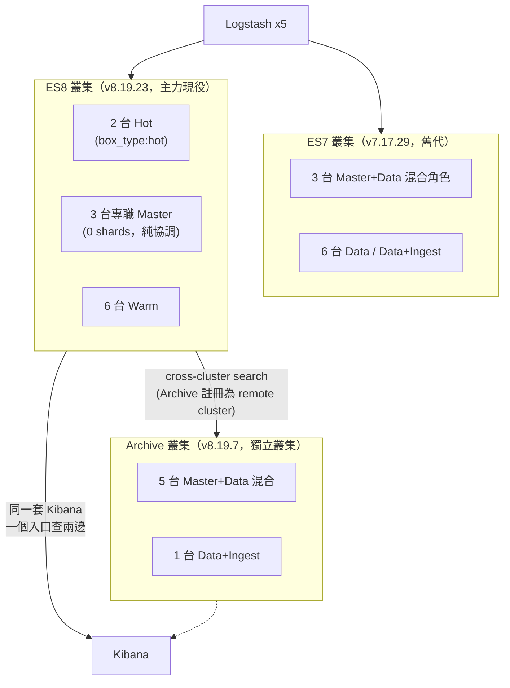

# ELK 架構演進紀錄

從「什麼都不懂就把 ELK 跑起來」到三座叢集並存、支撐資安 AI 分析的完整過程。
沒有一開始就設計好的藍圖，每一篇都是真實踩坑後的調整紀錄，不是教科書式的最佳實踐清單。

## 現況拓樸

| 叢集 | 節點數 | 已用容量 | 版本 | 角色分工 |
|---|---|---|---|---|
| ES7 | 9 | 38.1 TB | 7.17.29 | Master+Data 混合（舊代設計） |
| ES8 | 11 | 36.4 TB | 8.19.23 | 2 Hot + 3 專職 Master + 6 Warm，明確分層 |
| Archive | 6 | ~29.6 TB | 8.19.7 | 獨立叢集（非同叢集 ILM），非純備份、可查詢 |
| **合計** | **26** | **~104 TB** | — | Logstash 5 台 |

**查詢介面只有一套**：Kibana 接在 ES8 上，Archive 透過 cross-cluster search 註冊成 remote cluster，不用開第二套介面、不用記第二組帳密。

## 閱讀順序

| 順序 | 文章 | 講什麼 |
|---|---|---|
| 01 | [ELK 架構演進紀錄](01-elk-security-ai-architecture-evolution.md) | 從單版本、Master/Data 混用的第一版，到量大撐不住後重構成 Dedicated Master 的過程 |
| 02 | [LLM 與 ES 的 Security Chat 設計](02-elk-security-chat-llm-tool-calling.md) | 為什麼不能把 ES 資料直接塞給 LLM，兩階段 Tool Calling 架構怎麼設計 |
| 03 | [Security AI 平台的實際成果](03-elk-security-ai-results.md) | 不談技術，談營運上從「有資料但看不懂」到「打開就清楚」的具體變化 |
| 04 | [建歸檔叢集的真實記錄](04-elk-archive-cluster.md) | 為什麼加節點不是加硬碟、憑證架構從 per-node 改共用一張的推理、快照 vs 逐筆重索引的量級差異 |
| 05 | [真的搬一整個月資料量會踩到什麼](05-elk-archive-migration-sweep.md) | API 選錯差兩個數量級、低權限帳號安靜查不到東西、快照倉庫單執行緒排隊的真相 |
| 06 | [跨叢集查詢打通 Kibana](06-elk-cross-cluster-search-kibana.md) | 動態/靜態設定的重啟範圍判斷、雙向憑證驗證卡點、「以為有獨立設定選項」踩坑記錄 |
| 07 | [Heap/Swap/NFS 三個互相無關的坑](07-elk-heap-swap-recovery-throttle-nfs.md) | 例行健檢一次挖出 heap 被換到硬碟、兩個月前的緊急限流忘了解除、NFS 壞了沒人知道 |
| — | [Docker host-network 的原因與坑](elk-docker-host-network.md) | 三節點跨 VM 組叢集，為什麼 bridge 網路行不通、host-network 怎麼設 |

## 一句話總結這整個系列在講什麼

每一篇的坑都有同一個底層共同點：**「本來運作正常」跟「設計正確」是兩回事**——
Master/Data 混用一開始跑得動，憑證過期一年沒人發現因為連線本來就跳過驗證，
舊叢集冷啟動延遲存在了好幾個月但沒人系統性確認過。問題不是突然出現的，
是一直都在，只是沒被真正驗證過的東西，撐到某次真的被認真檢查才現形。
